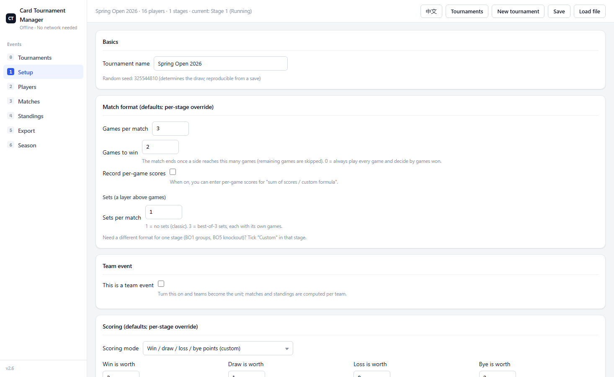
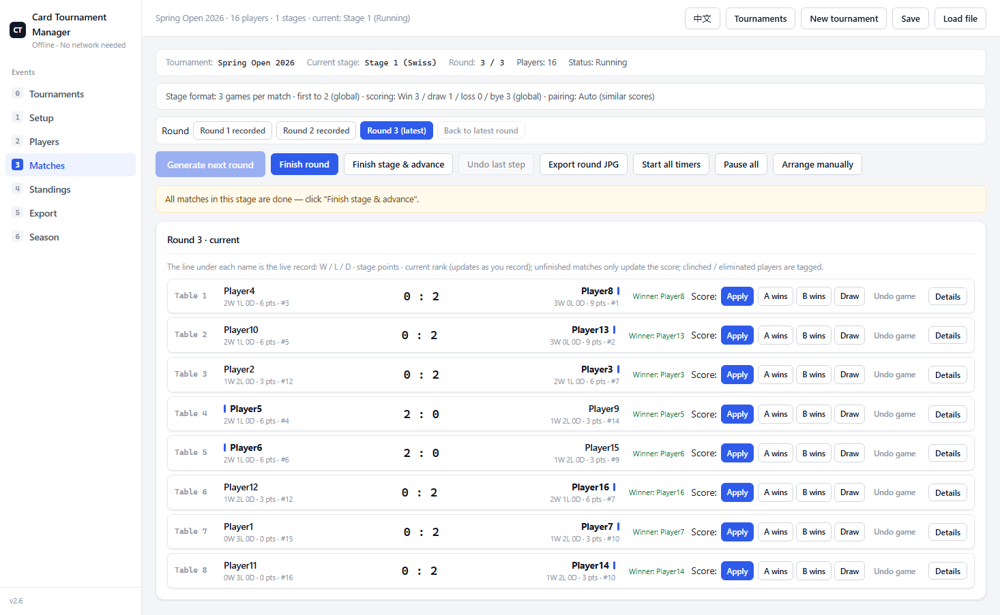
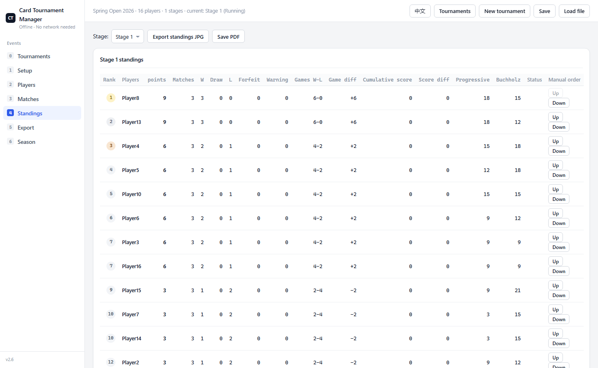
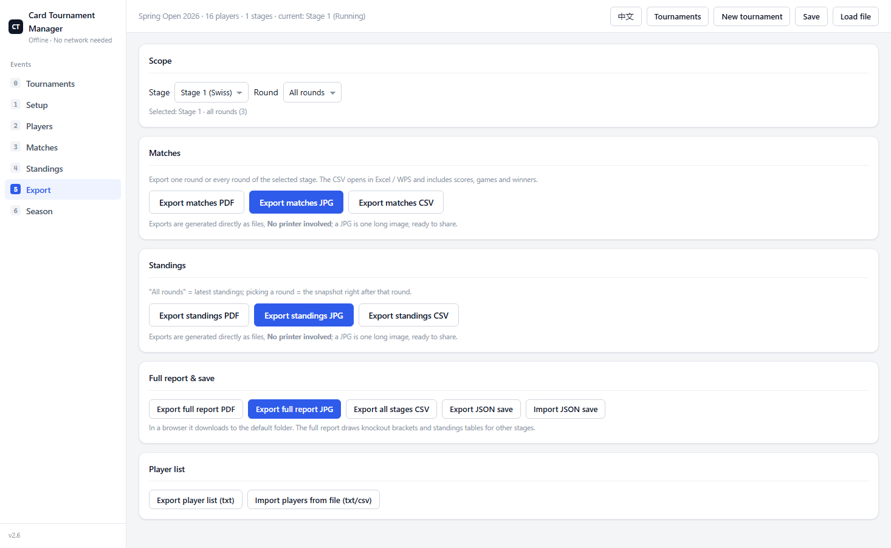

<div align="center">

# 🃏 Card Tournament Manager

**Pure static · works offline** — a tournament pairing, scoring and standings system for card games and tabletop events. One codebase ships as a **Windows desktop app** and an **Android app** (and runs in a browser).

**English** · [中文](README.md)

[](https://github.com/abcnyyy/card-tournament-manager/releases/latest)
[](https://github.com/abcnyyy/card-tournament-manager/releases)
[](https://github.com/abcnyyy/card-tournament-manager/stargazers)
[](LICENSE)
[](https://github.com/abcnyyy/card-tournament-manager/commits/main)
[](https://github.com/abcnyyy/card-tournament-manager/releases)
[](https://www.electronjs.org/)

**🌐 [Try it online (GitHub Pages)](https://abcnyyy.github.io/card-tournament-manager/) · 📖 [Full manual (English)](使用说明.en.md) · 📖 [使用说明（中文）](使用说明.md) · 💬 [Discussions](https://github.com/abcnyyy/card-tournament-manager/discussions)**

</div>

---

Swiss, single elimination, double elimination, round robin and group stages — all supported, chainable into multi-stage events, and **every format can also be paired by hand**. Matches can carry two levels (games → sets) and team events are supported. Everything is stored locally: no server, no network, no CDN. Built for card games, board games, chess and small leagues — anywhere you need fair pairing and scoring.

## ✨ Highlights

| Capability | What you get |
|---|---|
| 🏆 Five formats | Swiss (three pairing modes) · Single elimination · Double elimination · Round robin (multiple cycles) · Groups (Swiss / round robin / double elim inside a group) |
| 🔁 Multi-stage events | Chain any number of stages; advance or eliminate by rank, with either a fixed count or "ties advance together". The next stage can inherit **points + record (matches / W-D-L / games) + scores** |
| 🃏 Team events | **One table = one match**; n-vs-n / conquest / KOF; players fielded per side is configurable; line up first, then record |
| 🖐️ Manual pairing | **Every format can be paired manually**: pick pairings round by round in Swiss / round robin / groups (group by group), and seat players in the first-round slot table for single / double elim |
| 🔀 Half-bracket crossover | Optional crossover dropping: the first losers round always pairs losers of adjacent winners round-1 matches (both modes); when on, later waves of losers are reordered (reversed / reversed+shifted / shifted / unchanged) so recent opponents do not meet again. Structure stays standard double elim, winners-final loser goes straight into the losers final |
| 🎯 Games → sets | A match can consist of several sets, each using the same game format (e.g. "best of 3, each best of 5"); decided by sets won / total games / total points |
| 📊 Three scoring styles | By final rank / by wins / **by advancing to the next stage**; stacking is controlled per stage |
| 🧮 Tiebreakers | Game difference, score difference, progressive score, Buchholz and more; when inheriting, **matches / wins / draws / losses / games are carried at face value** while scores can be scaled; **stage points can be set per stage** |
| 🗓️ Seasons, three plans | **Each stop's own rules** (default) / **one shared season rule** / **one full rule per stage**; each stop row has a shortcut to that event's points table |
| 🚩 Warnings & forfeits | Record warnings / forfeits per side per match; they **feed the tiebreakers** (forfeits first, then warnings — fewer is better) in both the standings and the CSV |
| ⚡ Live records | Brackets, advancement paths and clinch / elimination update as you record |
| ⏱️ Timers | Per-table countdown; auto-settle at timeout using the current score |
| 📤 Exports | **No printer involved**: a PDF (auto-paginated A4) or **one long JPG** ready to share; knockout stages export as a **bracket**, plus CSVs and JSON saves |
| 🔄 Fully undoable | Any step can be undone |
| 📱 Cross-platform | Same front end packaged for Windows (Electron) and Android (Capacitor), responsive UI |
| 🌐 Bilingual | Chinese and English UI, switch any time from the top bar (the choice is remembered) |

## 🖼️ Screenshots

| Setup (English UI) | Matches (English UI) | Standings (English UI) | Export (English UI) |
|---|---|---|---|
|  |  |  |  |

> More in [docs/](docs/). All screenshots come from the real app.

## 🚀 Download (v3.0.1)

Grab it from **[Releases](https://github.com/abcnyyy/card-tournament-manager/releases/latest)**, or use the direct links:

| Platform | File | Size | Notes |
|---|---|---|---|
| Windows portable | [card-tournament-manager-3.0.1-portable.exe](https://github.com/abcnyyy/card-tournament-manager/releases/download/v3.0.1/card-tournament-manager-3.0.1-portable.exe) | 77 MB | Single exe, double-click to run, keeps your settings, USB-stick friendly |
| Windows installer | [card-tournament-manager-3.0.1-setup.exe](https://github.com/abcnyyy/card-tournament-manager/releases/download/v3.0.1/card-tournament-manager-3.0.1-setup.exe) | 77 MB | Installs locally, adds Start-menu / desktop shortcuts |
| Android | [card-tournament-manager-3.0.1.apk](https://github.com/abcnyyy/card-tournament-manager/releases/download/v3.0.1/card-tournament-manager-3.0.1.apk) | 3.8 MB | Phone / tablet, portrait-friendly |

> If Windows SmartScreen blocks the first run, choose "More info → Run anyway" (normal for unsigned apps).
> Full instructions: [使用说明.en.md](使用说明.en.md) (English) · [使用说明.md](使用说明.md) (中文).

## 🌐 Try it online

No install? Open the **[GitHub Pages build](https://abcnyyy.github.io/card-tournament-manager/)** and use it in the browser (data stays in *your* localStorage, nothing is uploaded).

## 📦 Run / build locally

**Web version (zero dependencies):**

```bash
# open it directly
app/index.html
# or serve it statically
python -m http.server 8080 --directory app
```

**Desktop / Android (development):**

```bash
npm install
npm start             # Electron desktop app
npm run dist:exe      # Windows: NSIS installer + portable exe → dist/
npm run cap:sync      # copy the web app into the Android project
npm run apk:debug     # Android debug APK (needs JDK 17 + Android SDK)
```

## 🧪 Tests

Everything runs **headless** (local static server + headless browser + CDP) — no windows pop up:

```bash
npm test                  # all engine / pure-logic suites (fast, no browser)
npm run test:smoke        # all UI smoke suites (needs a browser that can start headless)
npm run test:all          # both
node tools/test_v35.js    # 2.6.1 audit regressions (57 checks)
node tools/check_i18n.js  # English build: fails if any Chinese text is left in the UI
node tools/verify_pack.js # unpack app.asar from the build and re-run the suites
```

Naming: `test_*.js` are pure engine tests, `smoke_*.js` are UI tests.

## 🗂️ Layout

```
app/          static front end (index.html + css + js) — the app itself
  js/core.js     data model, constants, defaults, localStorage persistence
  js/formats.js  format algorithms (double-elim state machine, pairing, tiebreaks)
  js/engine.js   engine: pairing, settlement, points, ranks, export data
  js/exporter.js export & save
  js/ui.js       rendering & interaction
  js/i18n.js     bilingual runtime (language switch, DOM translation)
  js/i18n.en.js  Chinese → English dictionary + dynamic-string rules
electron/     desktop main process
android/      Capacitor Android project (Gradle)
tools/        tests & build scripts
docs/         design mockups & screenshots
```

## 🗺️ Roadmap

- [ ] Event templates (one-click common format combos)
- [ ] QR check-in / player self-reporting
- [ ] Big-screen mode (projected bracket + live scores)
- [x] English UI (i18n) — done, switch from the top bar
- [ ] Optional cloud sync (opt-in; offline stays the default)
- [ ] More formats: Swiss round robin, ladder, gauntlet

Ideas and feedback are welcome in [Discussions](https://github.com/abcnyyy/card-tournament-manager/discussions).

## 🤝 Contributing

Bug reports, feature ideas, docs and code are all welcome — see [CONTRIBUTING.md](CONTRIBUTING.md) and [CODE_OF_CONDUCT.md](CODE_OF_CONDUCT.md). For security issues use the private channel in [SECURITY.md](SECURITY.md).

### Contributors

<a href="https://github.com/abcnyyy/card-tournament-manager/graphs/contributors"></a>

Thanks to everyone who makes this tool better ❤️

## ❓ FAQ

- **Where is my data?** In the browser's / app's `localStorage`. Nothing is uploaded, and it works offline.
- **How do I record a team match?** Line up every board first (pick members in the "Team boards" table under the match card), then record results.
- **SmartScreen blocked me.** Choose "More info → Run anyway" — normal for unsigned apps.
- **How does the language switch work?** Click the top-bar button ("EN" / "中文"). The choice is remembered; English browsers start in English.
- **More details?** See [使用说明.en.md](使用说明.en.md).

## 📄 License

[MIT](LICENSE) © 2026 abcnyyy

---

<div align="center">

**If this helped you, a ⭐ star is the best support!**

</div>
