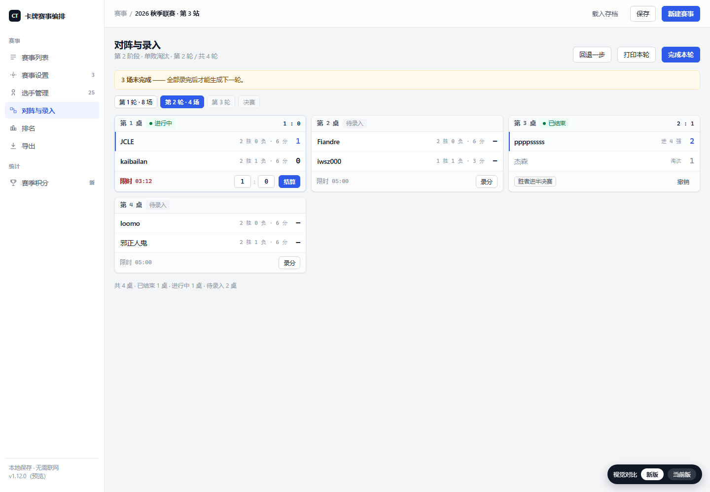
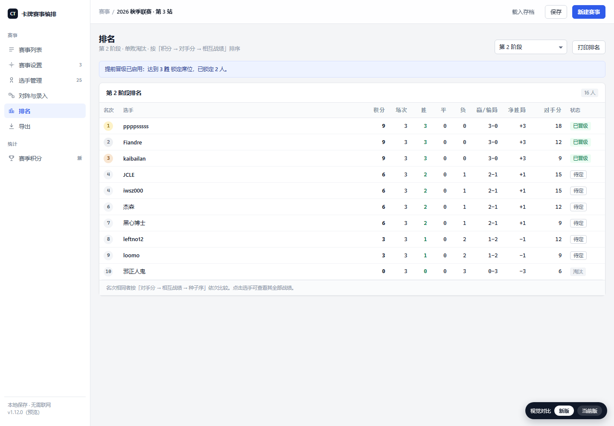
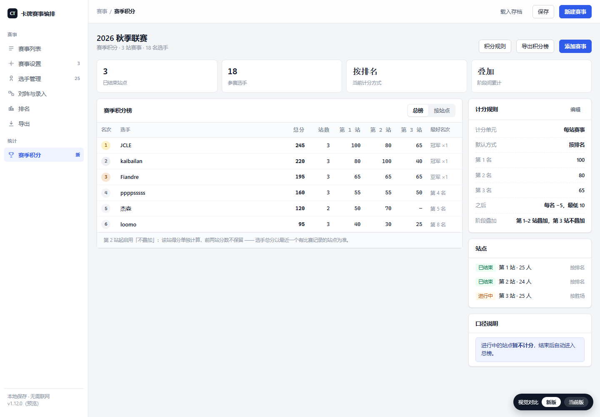
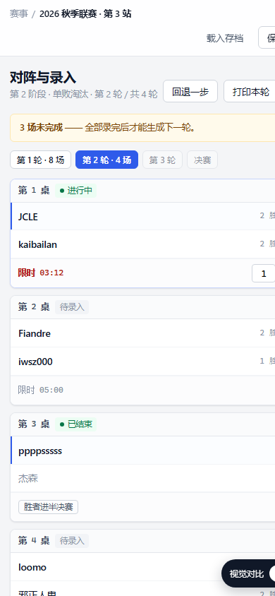

<div align="center">

# 🃏 卡牌赛事编排 · Card Tournament Manager

**纯静态 · 离线可用**的卡牌 / 桌游赛事编排与计分系统 —— 一套代码同时产出 **Windows 桌面端** 与 **Android 端**。

[](https://github.com/abcnyyy/card-tournament-manager/releases/latest)
[](https://github.com/abcnyyy/card-tournament-manager/releases)
[](https://github.com/abcnyyy/card-tournament-manager/stargazers)
[](LICENSE)
[](https://github.com/abcnyyy/card-tournament-manager/commits/main)
[](https://github.com/abcnyyy/card-tournament-manager/releases)
[](https://www.electronjs.org/)

**🌐 [在线试用（GitHub Pages）](https://abcnyyy.github.io/card-tournament-manager/) · 📖 [完整使用说明](使用说明.md) · 💬 [讨论区](https://github.com/abcnyyy/card-tournament-manager/discussions)**

</div>

---

瑞士轮、单败 / 双败淘汰、循环赛、小组赛全支持，可多阶段串联；支持「局 → 回合」两级比赛单位与团体赛；数据全部存本地，无需服务器、无需联网、零 CDN 依赖。适合**卡牌对战、桌游、棋牌、小型联赛**等一切需要公平编排与计分的场景。

## ✨ 核心特性

| 能力 | 说明 |
|---|---|
| 🏆 五大赛制 | 瑞士轮（三种配对）· 单败淘汰 · 双败淘汰 · 循环赛（多循环）· 小组赛（组内可再选瑞士轮/循环/双败） |
| 🔁 多阶段串联 | 一个赛事串任意多个阶段，按名次自动晋级 / 淘汰，名额可固定人数或同分同名次 |
| 🃏 团体赛 | **一桌 = 一场比赛**；n 对 n / 征服 / KOF 三赛制；每方上场人数可独立设置；先定人再录成绩 |
| 🎯 局 → 回合两级 | 一场比赛可打多个同局制的回合（如「3 回合 × 五局三胜」），按赢回合 / 大比分 / 得分定胜负 |
| 📊 积分三选一 | 按名次 / 按胜场 / **按是否晋级下一阶段**；阶段级叠加 / 不叠加独立控制 |
| 🧮 小分体系 | 净胜局、净小分、累进分、对手分等多种排序依据，可跨阶段继承 |
| ⚡ 实时战绩 | 对阵图、晋级路径、提前晋级 / 淘汰实时显示 |
| ⏱️ 计时器 | 每桌独立计时，到点按当前比分自动结算 |
| 📤 导出 | 一览导出（另存为 / 打印 PDF）、积分榜 CSV、原生保存对话框 |
| 🔄 全可撤销 | 任意一步操作都可撤销 |
| 📱 跨端 | 同一套前端打包为 Windows 桌面（Electron）与 Android（Capacitor），界面自适应 |

## 🖼️ 界面预览

| 对阵 / 录入 | 积分榜 | 赛季 | 移动端 |
|---|---|---|---|
|  |  |  |  |

> 更多截图见 [docs/](docs/)。所有界面均为本项目实际运行截图。

## 🚀 下载（v2.1）

前往 **[Releases](https://github.com/abcnyyy/card-tournament-manager/releases/latest)** 页面下载，或直接点下面的链接：

| 平台 | 文件 | 大小 | 说明 |
|---|---|---|---|
| Windows 绿色版 | [card-tournament-manager-2.1.0-portable.exe](https://github.com/abcnyyy/card-tournament-manager/releases/download/v2.1/card-tournament-manager-2.1.0-portable.exe) | 77 MB | 单个 exe，双击即用，无需安装，可放 U 盘 |
| Windows 安装版 | [card-tournament-manager-2.1.0-setup.exe](https://github.com/abcnyyy/card-tournament-manager/releases/download/v2.1/card-tournament-manager-2.1.0-setup.exe) | 77 MB | 安装到本机，生成开始菜单 / 桌面快捷方式 |
| Android | [card-tournament-manager-2.1.0.apk](https://github.com/abcnyyy/card-tournament-manager/releases/download/v2.1/card-tournament-manager-2.1.0.apk) | 3.8 MB | 手机 / 平板安装，界面自适应竖屏 |

> Windows 版首次运行若被 SmartScreen 拦下，点「更多信息 → 仍要运行」即可（未签名应用都这样）。
> 完整操作说明见仓库内的 [使用说明.md](使用说明.md)。

## 🌐 在线试用

不想下载？直接打开 **[GitHub Pages 在线版](https://abcnyyy.github.io/card-tournament-manager/)** 在浏览器里试用（数据存在你自己的浏览器 localStorage，不上传任何服务器）。

## 📦 本地运行 / 构建

**Web 版（零依赖，双击即用）：**

```bash
# 直接用浏览器打开
app/index.html
# 或起本地静态服务
python -m http.server 8080 --directory app
```

**桌面 / 安卓（开发）：**

```bash
npm install
npm start             # 启动 Electron 桌面端
npm run dist:exe      # 打包 Windows：NSIS 安装包 + 便携版 exe → dist/
npm run cap:sync      # 同步前端到安卓工程
npm run apk:debug     # Android 调试版 APK（需本机 JDK 17 + Android SDK）
```

## 🧪 测试

所有测试均为**无头运行**（本地静态服务 + 无头浏览器 + CDP），不会弹出任何窗口：

```bash
node tools/test_engine.js     # 引擎核心
node tools/test_v29.js        # 最新版本专项用例（一桌一场 / 排阵 / 上场人数 / 三赛制胜负）
node tools/smoke_flow.js      # 端到端流程
node tools/smoke_v29.js       # 界面冒烟
node tools/verify_pack.js     # 从打包产物 app.asar 解包复跑
```

命名规则：`test_*.js` 纯引擎测试，`smoke_*.js` 界面测试。

## 🗂️ 目录结构

```
app/          纯静态前端（index.html + css + js）—— 核心应用本体
  js/core.js     数据模型、常量、默认值、localStorage 持久化
  js/formats.js  赛制算法（双败状态机、配对、加赛）
  js/engine.js   引擎：编排、结算、积分、名次、导出数据准备
  js/exporter.js 导出与保存
  js/ui.js       界面渲染与交互
electron/     桌面端主进程
android/     Capacitor 安卓工程（Gradle）
tools/       测试与构建脚本
使用说明.md  完整使用文档
docs/        设计稿与截图
```

## 🗺️ 路线图（Roadmap）

- [ ] 赛事模板库（一键套用常见赛制组合）
- [ ] 二维码签到 / 选手扫码自助录入
- [ ] 直播大屏模式（投影对阵 + 实时比分）
- [ ] 英文界面（i18n）
- [ ] 可选云同步（非强制，默认仍离线）
- [ ] 更多赛制：循环瑞士、阶梯赛、擂台赛

欢迎在 [Discussions](https://github.com/abcnyyy/card-tournament-manager/discussions) 提想法。

## 🤝 贡献

Bug 报告、功能建议、文档与代码都欢迎！请看 [贡献指南](CONTRIBUTING.md) 与 [行为准则](CODE_OF_CONDUCT.md)。安全漏洞请走 [SECURITY.md](SECURITY.md) 的私信渠道。

### 贡献者

<a href="https://github.com/abcnyyy/card-tournament-manager/graphs/contributors"></a>

感谢每一位让这个工具变得更好的人 ❤️

## ❓ 常见问题

- **数据存哪？** 全部存在浏览器 / 应用的 `localStorage`，不上传服务器，离线可用。
- **团体赛怎么录？** 先在对阵卡下方的「团体对阵」表里给每场定好人（下拉选队员），再录成绩。
- **未签名被拦？** 点「更多信息 → 仍要运行」即可，这是未签名应用的正常现象。
- **更多玩法？** 见 [使用说明.md](使用说明.md)。

## 📄 许可

[MIT](LICENSE) © 2026 abcnyyy

---

<div align="center">

**如果它帮到了你，点个 ⭐ Star 就是最大的支持！**

</div>
